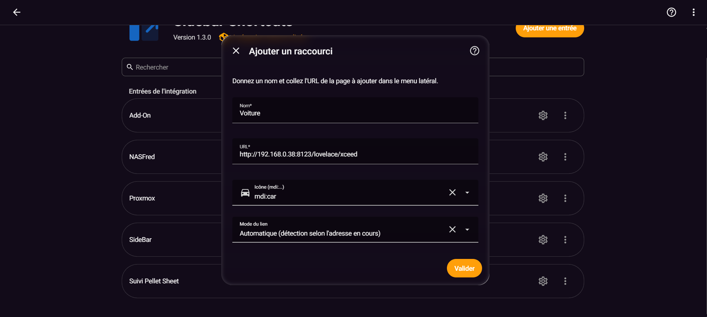
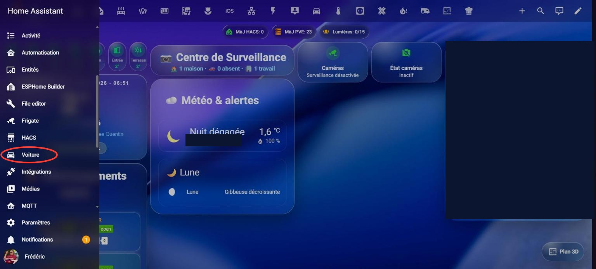
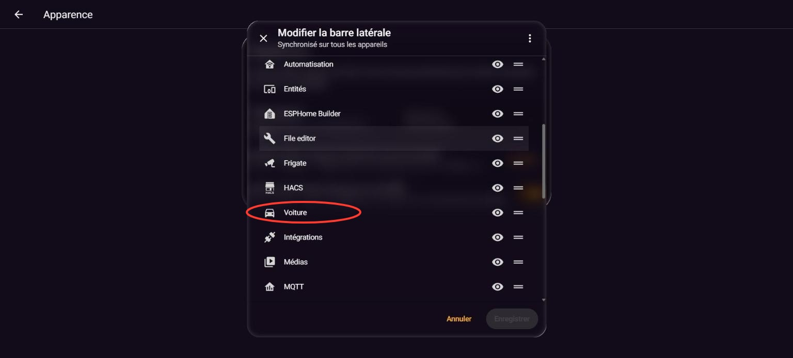

# Sidebar Shortcuts

---

### ❤️ Sponsors GitHub

<!--START_SECTION:github-sponsors-->
<!-- Aucun sponsor GitHub public actif pour le moment -->
<!--END_SECTION:github-sponsors-->

---
### ☕ Merci aux donateurs

<!--START_SECTION:paypal-->

<!--END_SECTION:paypal-->

<!--START_SECTION:buy-me-a-coffee-->
<!-- Les nouveaux dons seront ajoutés ici automatiquement -->
<!--END_SECTION:buy-me-a-coffee-->

---

 

### ☕ Offrez-moi un café pour m'aider à rester éveillé et coder vos intégrations préférées !

En remerciement, votre nom apparaîtra (de façon anonymisée) dans la section « ☕ Merci aux donateurs » ci-dessus.

---

Add shortcuts to any page — inside Home Assistant or on another site/device — to the sidebar, without touching `configuration.yaml` and without a restart.

*[Français ci-dessous](#français)*

---

## English

### What it does

Give it a name, paste a full URL — `http://` or `https://` (e.g. `https://homeassistant.local:8123/lovelace/xceed` or `http://192.168.0.38:8123/config/integrations`) — and the shortcut shows up immediately in the sidebar.

- **Internal link** (a page on your own Home Assistant instance): navigation happens in place, inside the Home Assistant page itself — the same principle as `panel_custom` + `panel-redirect.js`, not an iframe — so it works everywhere your Home Assistant is reachable (local network, remote HTTPS access, Nabu Casa...), with none of the mixed-content restrictions an iframe has.
- **External link** (another site, a NAS, a router...): it opens in a new browser tab, exactly like a normal link. No iframe limitations (X-Frame-Options, mixed content) apply since the page is never embedded in Home Assistant.
- **Link mode** *(optional)*: by default ("Auto"), internal vs. external is detected automatically by comparing the shortcut's address to the one you're currently using. If you reach Home Assistant from more than one address (local IP, Nabu Casa, a VPN...), that auto-detection can misfire on a shortcut configured from a different address — set the link mode to "Always internal" or "Always external" on that shortcut to force the right behavior.

-------------------------------------------------------------------------------------------------------------------------------------------------------------------
### Screenshots

**Setting up a shortcut** (native icon picker with live preview, plus the link mode selector):

**The shortcut in the sidebar**:

**Reordering the sidebar** (Profile → Edit sidebar):

-------------------------------------------------------------------------------------------------------------------------------------------------------------------
### Installation

**Via HACS (recommended):**

1. Open Sidebar Shortcuts in HACS and install it:

   
   

   or simply search for **Sidebar Shortcuts** in HACS — it's part of HACS's default repository list, so it shows up directly in the store, no custom repository needed.
2. **Restart** Home Assistant (once, to load the integration itself).

**Not showing up in search yet?** Sidebar Shortcuts was only just accepted into HACS's default list — if your instance's catalog hasn't picked it up yet, add it as a custom repository in the meantime: HACS → **⋮** menu → **Custom repositories** → repository `https://github.com/cyclope205/sidebar-shortcuts`, type **Integration** → **Add**, then search and download as above.

**Manual installation:**

Copy the `custom_components/sidebar_shortcuts` folder into `/config/custom_components/`, then restart Home Assistant.

-------------------------------------------------------------------------------------------------------------------------------------------------------------------
### Usage

1. **Settings → Devices & services → Add integration → Sidebar Shortcuts.**
2. Fill in:
   - **Name**: the text shown in the sidebar;
   - **URL**: the full address of the page (`http://...` or `https://...`) — internal to Home Assistant or external (NAS, router, another site);
   - **Icon** *(optional)*: Home Assistant's native icon picker, with a live preview — [Material Design Icons](https://pictogrammers.com/library/mdi/) (`mdi:...`) and any extra icon pack you have installed (e.g. [Custom brand icons](https://github.com/elax46/custom-brand-icons), `phu:` prefix). Default: `mdi:link-variant`.
   - **Link mode** *(optional)*: "Auto" (default, detects internal vs. external automatically), "Always internal" or "Always external" — see above.
3. Confirm: the shortcut appears right away in the sidebar, no restart needed.

⚠️ **Use a web browser** (desktop or mobile) to set up a shortcut, not the Home Assistant Companion app: the page URL you need to copy only ever shows up in a browser's address bar — the Companion app never displays it.

To add another shortcut, repeat the same steps: **Add integration → Sidebar Shortcuts** again. Each shortcut is an independent entry, visible and manageable separately under **Settings → Devices & services**.

-------------------------------------------------------------------------------------------------------------------------------------------------------------------
### Editing or removing a shortcut

- **Edit**: on the shortcut's card (Settings → Devices & services), click **Configure** to change the name, URL, icon or link mode. The shortcut updates immediately.
- **Remove**: card's **⋮** menu → **Delete**. The shortcut disappears from the sidebar right away.
- **Reorder**: like any sidebar item, drag-and-drop order/visibility from **Profile → Edit sidebar** (click your name/avatar at the bottom of the sidebar).

-------------------------------------------------------------------------------------------------------------------------------------------------------------------
### FAQ / troubleshooting

**The shortcut doesn't show up after adding it.** Reload the page (Ctrl + Shift + R). If it persists, check in Settings → Devices & services that the integration is in the "loaded" state.

**The internal shortcut doesn't go where I want / stays on the wrong page.** For an internal link, the redirect only uses the path of the URL you entered (whatever follows your server's address), never the domain or protocol — this is intentional, so the shortcut works no matter where you're accessing Home Assistant from.

**A shortcut opens in a new tab when it should stay inside Home Assistant (or the other way around).** This happens when you reach Home Assistant from more than one address (local IP, Nabu Casa, VPN...) and the automatic internal/external detection guesses wrong for the address you're currently using. Edit the shortcut and set **Link mode** to "Always internal" or "Always external" to fix it permanently.

**Can I link to an external site or another device (NAS, router...)?** Yes. The shortcut automatically detects it's a different origin and opens it in a new browser tab, exactly like a normal link. There's no restriction on the HA side — the target device or site just needs to be reachable from whatever device you're clicking on (same network, VPN, that service's own remote access...).

**I have several shortcuts to add, do I need to restart each time?** No. A restart is only needed once, after the integration itself is first installed (so Home Assistant discovers the new `sidebar_shortcuts` domain). Every shortcut added afterwards appears immediately.

**Can I restrict a shortcut to admins only?** Not yet in this version — every household user sees every shortcut. Open an issue if this would be useful to you.

-------------------------------------------------------------------------------------------------------------------------------------------------------------------
### License

See [LICENSE](LICENSE).

---

## Français

### Ce que ça fait

Donnez un nom, collez une URL complète — `http://` ou `https://` (par exemple `https://homeassistant.local:8123/lovelace/xceed` ou `http://192.168.0.38:8123/config/integrations`) — et le raccourci apparaît immédiatement dans la barre latérale.

- **Lien interne** (une page de votre propre Home Assistant) : la navigation se fait en interne, dans la page Home Assistant elle-même — le même principe que `panel_custom` + `panel-redirect.js`, pas une iframe — donc ça fonctionne partout où votre Home Assistant est accessible (réseau local, accès distant en HTTPS, Nabu Casa...), sans les restrictions de contenu mixte qu'une iframe impose.
- **Lien externe** (un autre site, un NAS, un routeur...) : il s'ouvre dans un nouvel onglet du navigateur, comme un lien classique. Aucune limite d'iframe (X-Frame-Options, contenu mixte) puisque la page n'est jamais intégrée dans Home Assistant.
- **Mode du lien** *(optionnel)* : par défaut ("Automatique"), interne ou externe est détecté automatiquement en comparant l'adresse du raccourci à celle que vous utilisez actuellement. Si vous accédez à Home Assistant depuis plusieurs adresses (IP locale, Nabu Casa, un VPN...), cette détection automatique peut se tromper sur un raccourci configuré depuis une autre adresse — réglez le mode sur "Toujours interne" ou "Toujours externe" sur ce raccourci pour forcer le bon comportement.

-------------------------------------------------------------------------------------------------------------------------------------------------------------------
### Captures d'écran

**Configuration d'un raccourci** (sélecteur d'icône natif avec aperçu, et le sélecteur de mode du lien) :

**Le raccourci dans le menu latéral** :

**Réorganiser la barre latérale** (Profil → Modifier la barre latérale) :

-------------------------------------------------------------------------------------------------------------------------------------------------------------------
### Installation

**Via HACS (recommandé) :**

1. Ouvrez Sidebar Shortcuts dans HACS et installez-le :

   
   

   ou recherchez simplement **Sidebar Shortcuts** dans HACS — il fait partie du dépôt par défaut de HACS, donc il apparaît directement dans le magasin, sans dépôt personnalisé à ajouter.
2. **Redémarrez** Home Assistant (une seule fois, pour charger l'intégration elle-même).

**Pas encore visible dans la recherche ?** Sidebar Shortcuts vient tout juste d'être accepté dans le dépôt par défaut de HACS — si le catalogue de votre instance ne l'a pas encore récupéré, ajoutez-le en dépôt personnalisé en attendant : HACS → menu **⋮** → **Dépôts personnalisés** → dépôt `https://github.com/cyclope205/sidebar-shortcuts`, type **Intégration** → **Ajouter**, puis recherchez et téléchargez comme ci-dessus.

**Installation manuelle :**

Copiez le dossier `custom_components/sidebar_shortcuts` dans `/config/custom_components/`, puis redémarrez Home Assistant.

-------------------------------------------------------------------------------------------------------------------------------------------------------------------
### Utilisation

1. **Paramètres → Appareils et services → Ajouter une intégration → Sidebar Shortcuts.**
2. Renseignez :
   - **Nom** : le texte affiché dans le menu latéral ;
   - **URL** : l'adresse complète de la page (`http://...` ou `https://...`) — interne à Home Assistant ou externe (NAS, routeur, autre site) ;
   - **Icône** *(optionnel)* : sélecteur d'icône natif Home Assistant, avec aperçu en temps réel — icônes [Material Design Icons](https://pictogrammers.com/library/mdi/) (`mdi:...`) et tout pack d'icônes additionnel installé (par exemple [Custom brand icons](https://github.com/elax46/custom-brand-icons), préfixe `phu:`). Par défaut : `mdi:link-variant`.
   - **Mode du lien** *(optionnel)* : "Automatique" (par défaut, détecte interne/externe automatiquement), "Toujours interne" ou "Toujours externe" — voir ci-dessus.
3. Validez : le raccourci apparaît aussitôt dans la barre latérale, sans redémarrage.

⚠️ **Pour configurer un raccourci, utilisez un navigateur web** (sur ordinateur ou mobile), pas l'application compagnon Home Assistant : c'est dans la barre d'adresse du navigateur que vous pouvez copier l'URL de la page à raccourcir. L'application compagnon ne montre jamais cette URL.

Pour ajouter un autre raccourci, répétez l'opération : **Ajouter une intégration → Sidebar Shortcuts** à nouveau. Chaque raccourci est une entrée indépendante, visible et gérable séparément dans **Paramètres → Appareils et services**.

-------------------------------------------------------------------------------------------------------------------------------------------------------------------
### Modifier ou supprimer un raccourci

- **Modifier** : sur la carte du raccourci concerné (Paramètres → Appareils et services), cliquez sur **Configurer** pour changer le nom, l'URL, l'icône ou le mode du lien. Le raccourci se met à jour immédiatement.
- **Supprimer** : menu **⋮** de la carte → **Supprimer**. Le raccourci disparaît aussitôt de la barre latérale.
- **Réorganiser** : comme tout élément de la barre latérale, l'ordre et la visibilité se règlent par glisser-déposer dans **Profil → Modifier la barre latérale** (cliquez sur votre nom/avatar en bas de la barre latérale).

-------------------------------------------------------------------------------------------------------------------------------------------------------------------
### FAQ / dépannage

**Le raccourci n'apparaît pas après l'ajout.** Rechargez la page (Ctrl + Maj + R). Si ça persiste, vérifiez dans Paramètres → Appareils et services que l'intégration est bien à l'état « chargé ».

**Le raccourci interne ne va pas où je veux / reste sur la mauvaise page.** Pour un lien interne, la redirection n'utilise que le chemin de l'URL renseignée (ce qui suit l'adresse de votre serveur), jamais le domaine ou le protocole — c'est voulu, pour que le raccourci marche quel que soit l'endroit d'où vous accédez à Home Assistant.

**Un raccourci s'ouvre dans un nouvel onglet alors qu'il devrait rester dans Home Assistant (ou l'inverse).** Cela arrive si vous accédez à Home Assistant depuis plusieurs adresses (IP locale, Nabu Casa, VPN...) et que la détection automatique interne/externe se trompe pour l'adresse que vous utilisez actuellement. Modifiez le raccourci et réglez **Mode du lien** sur "Toujours interne" ou "Toujours externe" pour corriger ça durablement.

**Puis-je mettre un lien vers un site externe ou un autre appareil (NAS, routeur...) ?** Oui. Le raccourci détecte automatiquement qu'il s'agit d'une autre origine et l'ouvre dans un nouvel onglet du navigateur, exactement comme un lien classique. Il n'y a pas de restriction côté HA — en revanche, l'appareil ou le site visé doit bien sûr être joignable depuis l'appareil sur lequel vous cliquez (même réseau, VPN, accès distant propre à ce service...).

**J'ai plusieurs raccourcis à ajouter, dois-je redémarrer à chaque fois ?** Non. Le redémarrage n'est nécessaire qu'une fois, après l'installation initiale de l'intégration elle-même (pour que Home Assistant découvre le nouveau domaine `sidebar_shortcuts`). Chaque raccourci ajouté ensuite apparaît immédiatement.

**Puis-je limiter un raccourci aux administrateurs ?** Pas encore dans cette version — tous les utilisateurs du foyer voient tous les raccourcis. Ouvrez une issue si ce réglage vous est utile.

-------------------------------------------------------------------------------------------------------------------------------------------------------------------
### Licence

Voir [LICENSE](LICENSE).
