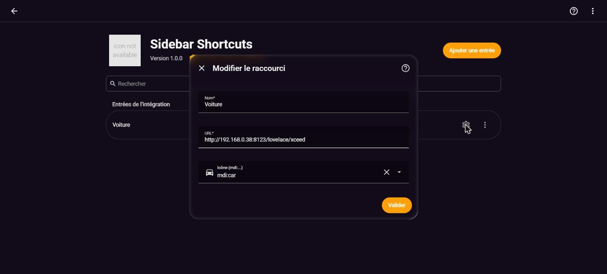

# 🔗 Sidebar Shortcuts

**Ajoutez des raccourcis vers n'importe quelle page de Home Assistant (ou vers un site/appareil externe) dans le menu latéral, sans toucher à `configuration.yaml` et sans redémarrage.**

Donnez un nom, collez une URL (ou juste le chemin, par exemple `/lovelace/xceed` ou `/config/integrations`), et le raccourci apparaît immédiatement dans la barre latérale.

- **Lien interne** (une page de votre propre Home Assistant) : la navigation se fait en interne, dans la page Home Assistant elle-même — le même principe que `panel_custom` + `panel-redirect.js`, pas une iframe — donc ça fonctionne partout où votre Home Assistant est accessible (réseau local, accès distant en HTTPS, Nabu Casa...), sans les restrictions de contenu mixte qu'une iframe impose.
- **Lien externe** (un autre site, un NAS, un routeur...) : il s'ouvre dans un nouvel onglet du navigateur, comme un lien classique. Aucune limite d'iframe (X-Frame-Options, contenu mixte) puisque la page n'est jamais intégrée dans Home Assistant.

---

## Sommaire

- [Installation](#installation)
- [Captures d'écran](#captures-décran)
- [Utilisation](#utilisation)
- [Modifier ou supprimer un raccourci](#modifier-ou-supprimer-un-raccourci)
- [FAQ / dépannage](#faq--dépannage)
- [Crédits & licence](#crédits--licence)

---

## Installation

### Via HACS (recommandé)

1. HACS → menu **⋮** → **Dépôts personnalisés**.
2. Dépôt : `https://github.com/cyclope205/sidebar-shortcuts`. Type : **Intégration**. Cliquez sur **Ajouter**.
3. Recherchez **Sidebar Shortcuts** → **Télécharger**.
4. **Redémarrez** Home Assistant (une seule fois, pour charger l'intégration elle-même).

### Manuelle

Copiez le dossier `custom_components/sidebar_shortcuts` dans `/config/custom_components/`, puis redémarrez Home Assistant.

---

## Captures d'écran

**Configuration d'un raccourci** (sélecteur d'icône natif avec aperçu) :

**Le raccourci dans le menu latéral** :

**Réorganiser la barre latérale** (Profil → Modifier la barre latérale) :

---

## Utilisation

1. **Paramètres → Appareils et services → Ajouter une intégration → Sidebar Shortcuts.**
2. Renseignez :
   - **Nom** : le texte affiché dans le menu latéral ;
   - **URL** : l'adresse de la page (complète, `https://...`) — interne à Home Assistant ou externe (NAS, routeur, autre site) ;
   - **Icône** *(optionnel)* : sélecteur d'icône natif Home Assistant, avec aperçu en temps réel — icônes [Material Design Icons](https://pictogrammers.com/library/mdi/) (`mdi:...`) et tout pack d'icônes additionnel installé (par exemple [Custom brand icons](https://github.com/elax46/custom-brand-icons), préfixe `phu:`). Par défaut : `mdi:link-variant`.
3. Validez : le raccourci apparaît aussitôt dans la barre latérale, sans redémarrage.

⚠️ **Pour configurer un raccourci, utilisez un navigateur web** (sur ordinateur ou mobile), pas l'application compagnon Home Assistant : c'est dans la barre d'adresse du navigateur que vous pouvez copier l'URL de la page à raccourcir. L'application compagnon ne montre jamais cette URL.

Pour ajouter un autre raccourci, répétez l'opération : **Ajouter une intégration → Sidebar Shortcuts** à nouveau. Chaque raccourci est une entrée indépendante, visible et gérable séparément dans **Paramètres → Appareils et services**.

---

## Modifier ou supprimer un raccourci

- **Modifier** : sur la carte du raccourci concerné (Paramètres → Appareils et services), cliquez sur **Configurer** pour changer le nom, l'URL ou l'icône. Le raccourci se met à jour immédiatement.
- **Supprimer** : menu **⋮** de la carte → **Supprimer**. Le raccourci disparaît aussitôt de la barre latérale.
- **Réorganiser** : comme tout élément de la barre latérale, l'ordre et la visibilité se règlent par glisser-déposer dans **Profil → Modifier la barre latérale** (cliquez sur votre nom/avatar en bas de la barre latérale).

---

## FAQ / dépannage

**Le raccourci n'apparaît pas après l'ajout.** Rechargez la page (Ctrl + Maj + R). Si ça persiste, vérifiez dans Paramètres → Appareils et services que l'intégration est bien à l'état « chargé ».

**Le raccourci interne ne va pas où je veux / reste sur la mauvaise page.** Pour un lien interne, la redirection n'utilise que le chemin de l'URL renseignée (ce qui suit l'adresse de votre serveur), jamais le domaine ou le protocole — c'est voulu, pour que le raccourci marche quel que soit l'endroit d'où vous accédez à Home Assistant.

**Puis-je mettre un lien vers un site externe ou un autre appareil (NAS, routeur...) ?** Oui. Le raccourci détecte automatiquement qu'il s'agit d'une autre origine et l'ouvre dans un nouvel onglet du navigateur, exactement comme un lien classique. Il n'y a pas de restriction côté HA — en revanche, l'appareil ou le site visé doit bien sûr être joignable depuis l'appareil sur lequel vous cliquez (même réseau, VPN, accès distant propre à ce service...).

**J'ai plusieurs raccourcis à ajouter, dois-je redémarrer à chaque fois ?** Non. Le redémarrage n'est nécessaire qu'une fois, après l'installation initiale de l'intégration elle-même (pour que Home Assistant découvre le nouveau domaine `sidebar_shortcuts`). Chaque raccourci ajouté ensuite apparaît immédiatement.

**Puis-je limiter un raccourci aux administrateurs ?** Pas encore dans cette version — tous les utilisateurs du foyer voient tous les raccourcis. Ouvrez une issue si ce réglage vous est utile.

---

## Crédits & licence

Code : licence **MIT** — © cyclope205.

Les liens internes s'appuient sur l'API native `panel_custom` de Home Assistant et sur le mécanisme `history.replaceState` popularisé par le script communautaire `panel-redirect.js` — le même principe, mais piloté dynamiquement depuis Python (aucune écriture YAML, aucun redémarrage nécessaire par raccourci). Les liens externes utilisent simplement `window.open`, comme un lien classique.
